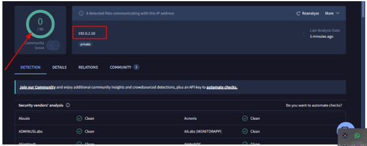
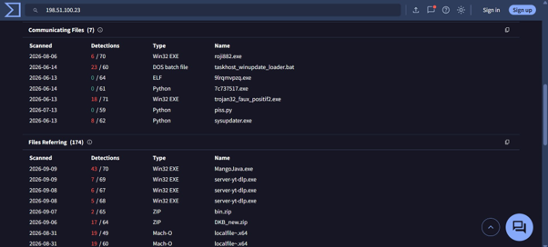
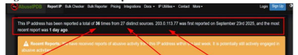
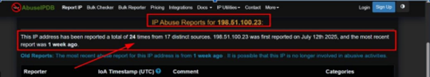

# Phishing Email Analysis

An investigation of a phishing email, focused on the IP addresses and domains found in its headers. Completed during my SOC Analyst internship at GiSOC as part of a simulated incident exercise. This write-up covers my own workstream.

## Objective
Identify the IP addresses and domains in the email headers, assess their reputation, investigate related files and relationships, and determine whether the email was a phishing attack and whether any file could be tied to the malware found in the wider investigation.

## Tools
VirusTotal, AbuseIPDB, DNS lookups

## Methodology
1. **Header analysis:** reviewed the email headers and extracted the IP addresses, domains, and other communicating indicators.
2. **Reputation checks:** checked each IP and domain in VirusTotal and AbuseIPDB.
3. **Looking beyond the first result:** the first reputation results did not give a clear conclusion, so I examined the relationships tied to each IP on VirusTotal, including communicating files.
4. **DNS analysis:** checked whether the domains still resolved and reviewed their registration, DNS, and reputation data.
5. **Indicator assessment:** identified indicators of compromise and concluded the email was a phishing attack.
6. **Correlation check:** compared the hashes of communicating files against the malware hash from the wider investigation before linking anything to the incident.

## Indicators of compromise
All indicators are defanged.

| Indicator | Type | Source | Result |
|---|---|---|---|
| `203[.]0[.]113[.]77` | IP address | Email header | AbuseIPDB: 36 reports from 27 sources; most recent 1 day ago |
| `198[.]51[.]100[.]23` | IP address | Email header | AbuseIPDB: 24 reports from 17 sources; VirusTotal: 7 communicating files |
| `192[.]0[.]2[.]10` | IP address | Email header | VirusTotal: 0/94 score, vendors clean, but 8 communicating files |
| `titanfrieghtsolutions[.]com` | Domain | Email | No DNS records; typosquatting |
| `quickdocverify[.]com` | Domain | Email | No DNS records |

## Findings

### IP reputation
- **`203[.]0[.]113[.]77`:** AbuseIPDB shows it was reported 36 times from 27 distinct sources, first on 23 September 2025, with the most recent report 1 day earlier. Reports include brute-force, port scanning, and web spam activity.
- **`198[.]51[.]100[.]23`:** AbuseIPDB shows 24 reports from 17 distinct sources, first reported on 12 July 2025, with the most recent report 1 week earlier. AbuseIPDB notes it may no longer be involved in abuse. VirusTotal lists 7 communicating files (several with high detection counts) and 174 referring files.
- **`192[.]0[.]2[.]10`:** VirusTotal shows a community score of 0 and all security vendors reporting it clean. However, 8 files were communicating with this IP. This is why the first result was inconclusive and I examined its relationships instead of stopping at the reputation score.

### DNS analysis: domains inactive
`titanfrieghtsolutions[.]com` and `quickdocverify[.]com` returned no DNS records. This suggests the attacker infrastructure may have been dismantled or taken down.

### Typosquatting
`titanfrieghtsolutions[.]com` misspells "freight" as "frieght", with the "i" and "e" transposed. Attackers use visually similar spellings like this to impersonate real organizations, a technique known as typosquatting. Spelling alone does not prove intent, so I checked the domain against registration, DNS, and reputation data as well.

### Trojan-flagged file
One communicating file had Trojan detections, but its hash did not match the malware hash from the wider investigation. I did not include it as a finding, because suspicious does not mean related to this incident.

## Conclusion
Based on the indicators above, I concluded the email was a phishing attack.

## Lessons learned
- A security tool does not always give a clear answer on the first lookup. When an indicator returns little, investigate its relationships.
- An inactive domain is still evidence. Missing DNS records can say something about the infrastructure.
- Correlation must be based on evidence, not assumptions.
- Patience, attention to detail, and clear documentation matter in an investigation.

## Skills demonstrated
Email header analysis, IP and domain reputation analysis, DNS analysis, typosquatting identification, indicator of compromise identification, evidence-based correlation, security documentation.

## Screenshots

### VirusTotal: 192[.]0[.]2[.]10

### VirusTotal: communicating files for 198[.]51[.]100[.]23

### AbuseIPDB: 203[.]0[.]113[.]77

### AbuseIPDB: 198[.]51[.]100[.]23

> All indicators are defanged. This is a training exercise and no live systems were targeted.
